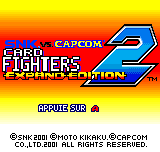
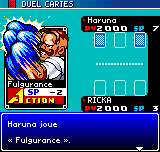

# SNK vs. Capcom - Card Fighters 2 Expand Edition — traduction française

**SNK vs. Capcom - Card Fighters 2 Expand Edition** (Neo Geo Pocket Color, SNK, 2001, sorti uniquement
au Japon), entièrement en français, traduit **depuis le japonais** : toute l'histoire, les menus, les
duels, les 424 cartes (noms, capacités, textes d'ambiance), le lexique des règles, le tutoriel, la boutique,
les échanges et les combats par câble, ainsi que les images : logo et écran titre, boutons, bandeaux,
bulles d'aide, plaques des lieux, étapes du tutoriel, écrans de duel.

<p align="center">
  
  
  
</p>

- **Partie 1 (français)** : jouer en français — le patch et comment l'appliquer.
- **Part 2 (English)** : the translation kit — tools and guide to translate the game into another language.

---

# Partie 1 — Jouer en français

## 1.1 Ce qu'il vous faut

Le patch : `patch/CardFighters2Expand_FR_v1.0.ips`.

**Votre propre** copie de la cartouche **japonaise**, non modifiée et sans en-tête. Aucune ROM n'est
fournie ici. Vérifiez-la :

| | ROM d'origine attendue |
|---|---|
| Nom (par exemple) | `SNK vs. Capcom - Card Fighters 2 - Expand Edition (Japan).ngc` |
| Taille | 2 097 152 octets |
| CRC32 | `CCBCFDA7` |
| MD5 | `ebc0e8c33d1a5e5be5457ad988233feb` |
| SHA-1 | `2c4fc8594f8ba2bf39e62fe8bcb79fc2df5a83b6` |

Si votre fichier contient déjà une partie sauvegardée (certains émulateurs l'écrivent dans la ROM), ses
empreintes seront différentes : ce n'est pas grave, le patch s'applique quand même. Avec une ROM déjà
traduite (en anglais par exemple), une ROM modifiée ou un autre dump, le patch donnera un jeu cassé.

## 1.2 Méthode A — patch appliqué à la volée par l'émulateur

L'émulateur applique le patch en mémoire à chaque lancement : la ROM d'origine n'est **pas modifiée**.
Posez le fichier `.ips` à côté de la ROM, **sous le même nom**, puis lancez la ROM normalement :

```
SNK vs. Capcom - Card Fighters 2 - Expand Edition (Japan).ngc
SNK vs. Capcom - Card Fighters 2 - Expand Edition (Japan).ips
```

Ce patch **agrandit** la ROM (2 Mio → 4 Mio). En cas de souci avec l'application à la volée, utilisez la
méthode B.

## 1.3 Méthode B — créer une ROM française (console, ou tout autre émulateur)

Fabriquez une fois pour toutes une ROM patchée :

- avec un outil IPS courant : **Rom Patcher JS** (dans le navigateur), **Flips** ou **Lunar IPS** ;
  choisissez la ROM, puis le `.ips`, et enregistrez le résultat ;
- ou avec l'outil fourni (Python 3) :

  ```
  python tools/ips.py apply "SNK vs. Capcom - Card Fighters 2 - Expand Edition (Japan).ngc" patch/CardFighters2Expand_FR_v1.0.ips CardFighters2Expand_FR.ngc
  ```

Depuis la ROM d'origine attendue, la ROM obtenue doit avoir ces empreintes, quel que soit l'outil :

| | ROM française obtenue |
|---|---|
| Taille | 4 194 304 octets |
| CRC32 | `9772C758` |
| SHA-1 | `6ba557f6f4821904fd7fc49252657e4869229bfd` |

## 1.4 Sauvegarde

La sauvegarde reste au même endroit et dans le même format que dans la cartouche japonaise : une partie
enregistrée avec la version japonaise peut être reprise, à condition que votre émulateur ou votre
cartouche la retrouve (même nom de fichier de sauvegarde, par exemple). Cela a été vérifié avec une
sauvegarde reprise d'une autre version du jeu.

## 1.5 Ce qui a été vérifié, ce qui ne l'a pas été (v1.0)

Vérifié à l'émulateur : écran titre et logo, début de l'histoire (prologue, saisie du nom, club de cartes,
école, bureau de la directrice), menu principal, atelier du deck (liste et fiches des cartes), lexique,
tutoriel, carte de la ville et plaques des lieux, plusieurs duels complets (messages d'attaque, de parade,
de renfort, cartes Action et Réaction, défausse, fin de partie), boutique (liste de rachat, fiche de carte,
messages), don d'une carte.

Tout le texte est contrôlé automatiquement contre le japonais (codes, largeur au pixel près de chaque
ligne, nombre de lignes des fenêtres, alignement des menus, caractères disponibles). Pas encore vu à
l'écran : la suite de l'histoire au-delà du début, la fenêtre de vente de la boutique, l'écran de
construction du deck, les modes à deux par câble. Un retour est bienvenu si un texte déborde ou se coupe.
La ROM n'a pas encore été essayée sur une vraie console.

## 1.6 Choix de traduction

- Traduit depuis le **japonais** : la traduction anglaise amateur existante résume, perd du contexte et
  contient des contresens (la boutique « achète » au lieu de racheter, « Prix x2 » au lieu de « prix
  unitaire »…). On **adapte** plutôt qu'on ne traduit mot à mot : chaque réplique doit avoir du sens dite
  par ce personnage, dans son registre.
- **Tutoiement et vouvoiement comme dans les traductions françaises de manga** : Haruna, la cadette,
  vouvoie son senpai Rikuto ; les élèves vouvoient les adultes. Les suffixes japonais (senpai, -kun, -chan)
  sont gardés.
- Les **tics de langage** sont gardés : Robomanto (« …, robo ! »), Dogou (« …, hein ! »), Fou
  (« …, aru ! »), Nanako (« …, wassa ! »), le ninja Fuwa et son langage d'antan.
- Les **noms japonais** des personnages du jeu sont gardés (Neomanto, Robomanto) ; les combattants SNK et
  Capcom portent leur nom officiel occidental. HP devient **PV**.
- Termes : deck, pioche, main, défausse, terrain, carte Action (AC), carte Réaction (RE), renfort, parer,
  attaque combinée, figé ; machine d'échange, détecteur de cartes, Match à mort, Match amical.
- Police : lettres à **largeur variable**, minuscules et accents ; clavier de saisie du nom en
  majuscules, minuscules et lettres accentuées.
- Laissés tels quels : ce qui est déjà en anglais dans le jeu japonais (« ARE YOU READY? », « GET A
  DECK? », « BATTLE POINT », « ALBUM », les sigles des séries, les mentions légales de l'écran titre).

## 1.7 Crédits

- **Traduction française, police, images, outils** : **Tixul**, sous **licence MIT** (fichier `LICENSE`)
  pour les outils et les fichiers de traduction.
- *SNK vs. Capcom - Card Fighters 2 Expand Edition* © 2001 SNK / Capcom. Ce projet de fans n'est ni affilié
  ni approuvé par les ayants droit. Il ne contient **ni ROM, ni BIOS, ni texte d'origine** : le patch ne
  contient que des octets modifiés, et le texte japonais n'est obtenu qu'en l'extrayant de sa propre ROM.

---

# Part 2 — Translation kit (English)

Everything needed to translate the game into **another Latin-alphabet language**. You edit text files;
the tools rebuild the ROM (4 MiB: translated text in a second chip, variable-width font with lowercase
and accented letters, automatic line wrapping and extra dialogue boxes, Latin name-entry keyboard,
translated card names and redrawn graphics) and the IPS patch.

| Folder / file | Content |
|---|---|
| `lang/fr/` | the French translation (`lot_NN_fr.tsv`) and its style guide `CONSIGNES.md` — use it as your template |
| `tools/` | extract the text, check a translation, build the translated ROM and the IPS patch |
| `tools/data/` | addresses of the tutorial and duel-start tiles, the finished title logo (`logo_fr.bin`) |
| `patch/` | the released French patch |
| `screenshots/` | the screenshots shown at the top of this file |
| `FORMAT.md` | technical notes on the ROM: text, font, display, graphics, saves (in French) |

## 2.1 Requirements
- Python 3.9 or later (no other package needed).
- The original **Japanese ROM** `SNK vs. Capcom - Card Fighters 2 - Expand Edition (Japan).ngc` (hashes in
  section 1.1): the game is rebuilt from it. The tools check it and refuse any other file (a save stored
  inside the file is ignored).

## 2.2 Steps
1. **Extract the text** from *your own* ROM (it is not distributed):
   ```
   python tools/extraire.py "SNK vs. Capcom - Card Fighters 2 - Expand Edition (Japan).ngc"
   ```
   This writes `out/src/lot_NN.tsv` (`index · type · Japanese · English`) and `out/src/lot_25.tsv` (card
   names). The English column is filled only if you add, as a second argument, an English-translated ROM
   that keeps the game's text table; it is a reading aid at best.
2. **Copy** `lang/fr` to `lang/<code>` (e.g. `lang/es`) and translate the `lot_NN_fr.tsv` files (rules
   below). A line missing from your files stays in Japanese.
3. **Check, then build** the ROM and the patch, and test in an emulator:
   ```
   python tools/controle.py --rom "SNK vs. Capcom - Card Fighters 2 - Expand Edition (Japan).ngc" --lang <code>
   python tools/build.py --rom "SNK vs. Capcom - Card Fighters 2 - Expand Edition (Japan).ngc" --lang <code> --ips
   ```
   Output: `out/<code>.ngc` and `out/<code>.ips` (checked by re-applying it).
   ⚠️ Distribute the **.ips** only, never the ROM.

## 2.3 File format and rules

Every `lot_*.tsv` file in `lang/<code>/` is read (UTF-8; `#` starts a comment line). One line per text:
`INDEX<TAB>text`, the index being the one in `out/src/lot_NN.tsv`. No tab and no real line break inside
a text.

Types (second column of the extracted lots):
- `D` (dialogue box, 3 lines): the Japanese is shown as boxes separated by ` ¶ ` (`⏎` = Japanese line
  break, not to be copied). Write each box in one piece and separate boxes with ` ¶ `: lines are wrapped
  automatically (136 px) and extra boxes are added when needed. `\n` forces a line break.
- `F n` (fixed window): at most `n` lines separated by `\n`, 136 px each. The rules glossary (3100-3199)
  is wrapped by the build.
- `N` (speaker name): 80 px at most.
- `M` (menu / columns): copy the `{M ..}` and `{I ..}` codes unchanged; `@` is an empty 8-px cell used
  for alignment: keep the Japanese columns, and no label wider than the Japanese one.
- `lot_25_*.tsv` (card names): `CARD<TAB>name<TAB>ability name`, 15 characters at most each; the name must
  fit in 55 px (card face).

Codes to keep: `{08 xx}` (speaker), `{10}` `{11}` (player names), `{12}` (card), `{13}` (ability), `{14}`
`{15}` `{18}` `{19}` (numbers, deck, pack), `{0C}` `{0D}` `{09}` `{0A}` (choices, waits), `{1EC}` etc.
(icons). A 3-digit code in the middle of a Japanese word is an unidentified kanji: do not copy it.

Characters: `A-Z a-z 0-9`, `. , ; : ! ? ' " - ( ) / + = % & * < > [ ] # ~ … « »` and
`é è ê ë à â î ï ô û ù ü ç œ É È Ê Ë À Â Ô Î Ù Û Ç Œ`. Glyphs (8×8, with their width) are drawn in
`tools/police.py`: add or change characters there.

`tools/controle.py` checks all of this against the Japanese of your ROM and exits with an error code
while a rule is broken.

Language-specific data living in the tools (edit them for your language):
- `tools/build.py`: name-entry keyboard (`CLAVIER`), Yes/No choice strings (`Oui` / `Non`);
- `tools/graphismes.py`: menu buttons (`BOUTONS`), banners (`BANDEAUX`), help bubbles (`BULLES`), title
  screen (`TITRE`), tutorial steps (`TUTO`), duel start (`DUEL`), the « PV » (HP) drawings, the name-entry
  banner, the JOYJOY shop sign;
- `tools/plaques.py`: place and name plates (`TEXTES`, `AUTONOMES`, `NOMS`);
- `tools/data/logo_fr.bin`: the title logo « CARD FIGHTERS », hand-finished, stored as final bytes
  (format in `tools/logo.py`).

The added code (variable-width text) is `tools/asm/vwf.asm`, shipped assembled (`vwf.bin`). To change it,
install the Macro Assembler AS (`asl`, `p2bin`) and set `ASL_DIR` to its folder before building.

## 2.4 Credits and legal
- French translation, font, graphics and tools: **Tixul**, released under the **MIT License** (see `LICENSE`).
- *SNK vs. Capcom - Card Fighters 2 Expand Edition* © 2001 SNK / Capcom. This fan project is not affiliated
  with or endorsed by the rights holders. It contains **no ROM, no BIOS and no original game text**; the
  Japanese text is only obtained by extracting it from your own ROM.
